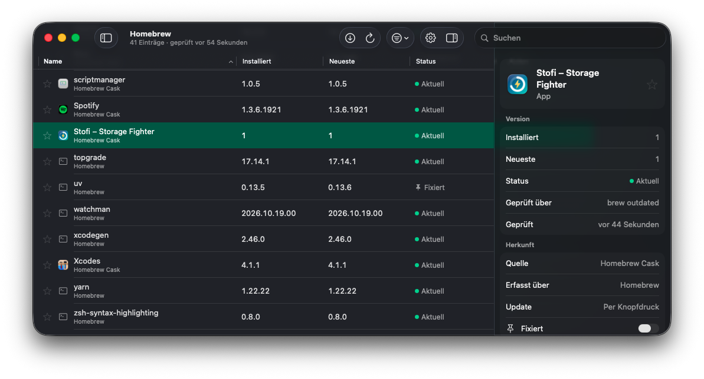
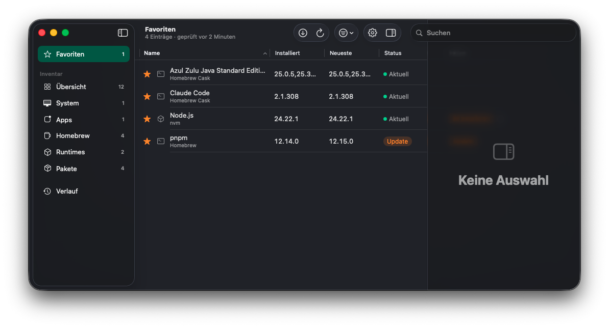
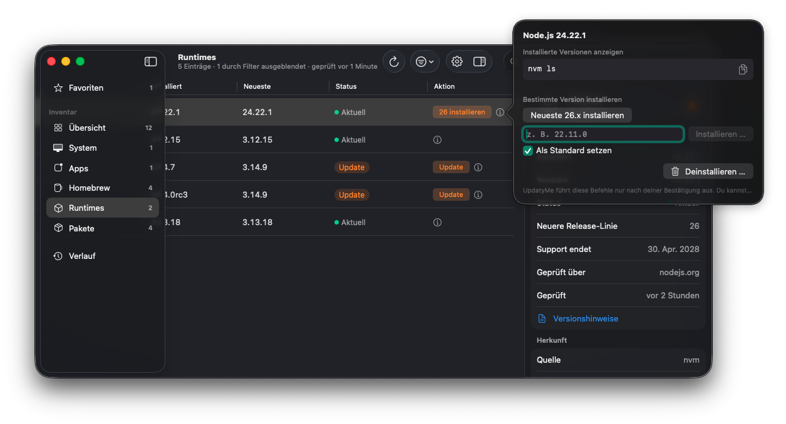

<div align="center">

# UpdatyMe

### Every update on your Mac. One window.

Apps, Homebrew, runtimes, global packages and macOS itself — UpdatyMe finds what's installed,
tells you what's outdated, and updates it when *you* say so.


[](LICENSE)



</div>

---

## Why UpdatyMe?

Keeping a developer Mac up to date usually means juggling a dozen commands:
`brew outdated`, `mas outdated`, `nvm ls-remote`, `pyenv install --list`, `rustup check`, `npm outdated -g`, `softwareupdate -l`…
and then remembering which apps update themselves and which don't.

**UpdatyMe puts all of that into a single, native macOS app.** It discovers everything you have installed,
checks each item against the right source, and shows you at a glance what's current and what needs attention.

## ✨ Highlights

### 🔍 One inventory for everything
UpdatyMe scans your Mac and groups what it finds into a clean sidebar:

| Category | What's in it |
|---|---|
| **System** | macOS and system software updates |
| **Apps** | Your apps — App Store, Sparkle-based and self-updating apps |
| **Homebrew** | Formulae and casks |
| **Runtimes** | Node.js, Python, Java, Rust and the versions you have installed |
| **Packages** | Globally installed packages (npm, pnpm, pipx, cargo, …) |
| **Favorites** | The tools you care about most, pinned in one place |
| **History** | Every update run, with its result |

### ✅ Know your status at a glance
Every entry shows the **installed** and the **newest** version side by side, with a clear status:
**Current**, **Update**, **Major update** or **Pinned**. Sort, filter and search across your whole machine in an instant.

<p align="center">
  
</p>

### 🧰 Built for developers
UpdatyMe understands the version managers you already use — **nvm, fnm, Volta, pyenv, uv, asdf, SDKMAN!, rustup** and more.
For runtimes it goes beyond "latest version":

- See which **release line** is newest and when **support ends** for the one you're on
- Install a **specific version** or the **newest version of a release line** in one click
- Set a freshly installed version as your **default**
- Uninstall old runtimes you no longer need
- Jump straight to the **release notes**

<p align="center">
  
</p>

### 🛡️ You stay in control
UpdatyMe never changes your system behind your back.

- **Nothing runs without confirmation** — every command is shown before it's executed, and you can copy it to run yourself
- **Pin** items you want to keep on a specific version
- **Running apps are detected** — UpdatyMe asks before quitting an app to update it, or skips it
- **Major updates are flagged**, so breaking changes never surprise you
- Uses **your real shell environment**, so it sees the same tools and `PATH` you do in Terminal

### ⚡ Update one, a few, or everything
Update a single item, a selection, or hit **Update All**. Updates run in a queue, report their progress,
and land in the **History** so you always know what changed and when.

### 🔔 Quietly in the background
- **Automatic checks** — every 6 or 12 hours, daily or weekly
- **Notifications** when new updates are available or a background run finished
- **Menu bar extra** for a quick look without opening the main window
- **Open at login**, if you like

### 🧩 Extensible without code
Missing a tool? Add it to a simple `tools.json` — tell UpdatyMe how to read the installed version
and where to look for the newest one (GitHub releases, npm, PyPI or any URL). No rebuild required.

```json
{
  "tools": [{
    "id": "gh",
    "name": "GitHub CLI",
    "command": "gh",
    "versionPattern": "gh version (\\S+)",
    "latest": { "type": "github", "repository": "cli/cli", "tagPattern": "v(.+)" }
  }]
}
```

### 🩺 Built-in diagnostics
Something not detected? The diagnostics view shows the resolved environment, detected version managers,
`PATH` and cache locations — so you can see exactly what UpdatyMe sees.

## 🍏 Native, fast and private

- **100 % Swift & SwiftUI**, designed for the latest macOS
- **No account, no telemetry, no server** — UpdatyMe talks directly to the official sources (Homebrew, App Store, nodejs.org, python.org, endoflife.date, GitHub, …)
- **Smart caching** keeps checks fast and network traffic low
- **Localized** in English and German

## 🚀 Getting started

**Requirements:** macOS 26 or later, Xcode 26 to build from source.

```bash
git clone https://github.com/DanielFiller30/UpdatyMe.git
```

```bash
open UpdatyMe/UpdatyMe.xcodeproj
```

Select the **UpdatyMe** scheme and press <kbd>⌘</kbd> <kbd>R</kbd>.

## 🤝 Contributing

Ideas, bug reports and pull requests are very welcome!
Support for a new ecosystem or version manager is a great place to start — open an issue and let's talk about it.

If UpdatyMe saves you a few minutes every week, consider leaving a ⭐ — it helps others find the project.

## 📄 License

UpdatyMe is released under the **MIT License** — see [LICENSE](LICENSE) for details.
